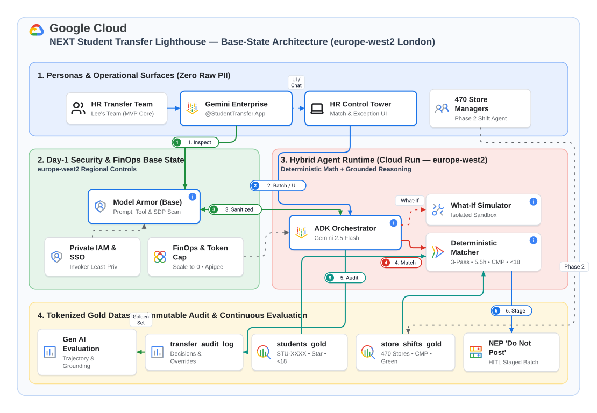
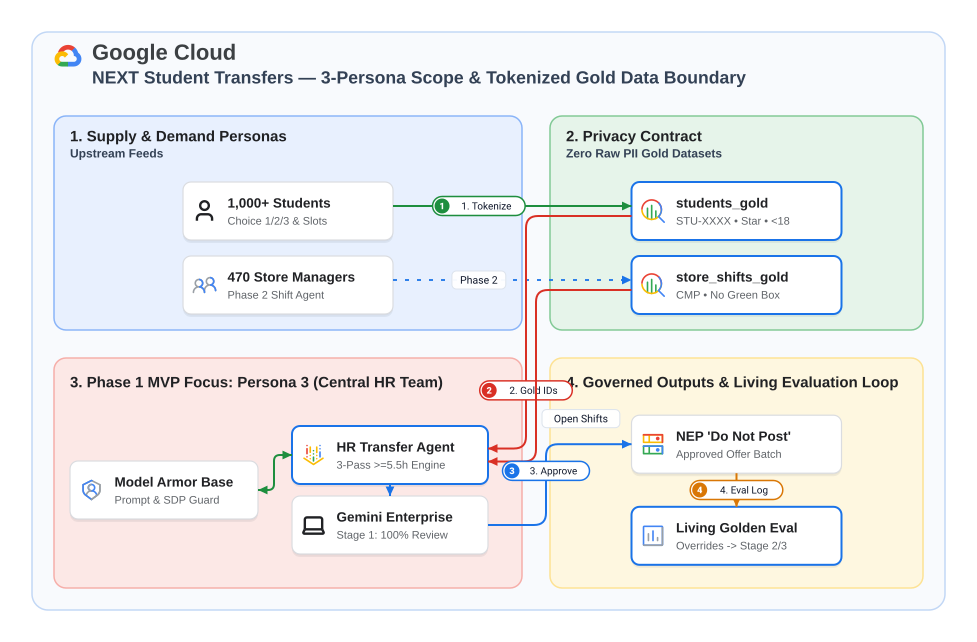
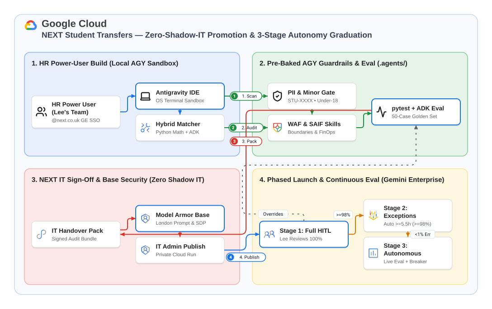

# NEXT PLC — Student Transfer Assistant (`Antigravity` + `Gemini Enterprise`)

> **Enterprise-Governed Multi-Agent HR & Retail Operations System on Google Cloud (`europe-west2`)**  
> Built with **Google Agent Development Kit (`ADK`)**, **Gemini Enterprise (`gemini-2.5-flash`, A2A v0.3)**, **BigQuery Medallion + Dataplex Auto Data Quality**, **Regional Model Armor (`europe-west2`)**, and **Cloud Run** fronted by a **Global External Application Load Balancer + Cloud IAP**.

---

## 1. What This Solution Is

The **NEXT Student Transfer Assistant** automates and governs the seasonal university student colleague transfer process across **`1,050` tokenized students** (`STU-XXXX`) and **`470` UK retail stores** (`1,093` open shifts, `SM-XXX` Store Managers).

It separates **Colleague & Store Manager Self-Service Intake** from **HR Multi-Agent Orchestration** using two strictly segregated Cloud Run services and a two-dataset BigQuery Medallion architecture in `europe-west2` (London):

1. **Cloud Run App 1 — Colleague & Store Manager Self-Service Portal ([`src/portal_server.py`](src/portal_server.py) + [`ui/portal_intake.html`](ui/portal_intake.html)):**
   - Fronted by a **Global External Application Load Balancer + Google-Managed SSL + Cloud IAP** (`https://${PORTAL_CUSTOM_DOMAIN}/ui`).
   - Allows Students (`STU-XXXX`) to submit Choice 1/2/3 store transfer preferences and Store Managers (`SM-XXX`) to publish shifts and clear the 3-day internal Contract Marketplace (`CMP`) window.
   - Writes append-only rows to BigQuery Bronze (`next_student_transfer_staging.portal_change_requests`), triggers **Dataplex Auto Data Quality (`next-student-transfer-dq-scan`)**, promotes valid updates to Gold (`next_student_transfer_gold`), and quarantines policy violations (`DQ-01..DQ-06`) for HR review.
2. **Cloud Run App 2 — Headless HR Multi-Agent A2A Backend ([`src/server.py`](src/server.py) + [`src/agent.py`](src/agent.py)):**
   - Registered natively in **Gemini Enterprise** over the **Agent-to-Agent (`A2A v0.3`) JSON-RPC 2.0 protocol** (`POST /a2a/app`) with `--no-allow-unauthenticated`.
   - Uses a **Root Coordinator (`next_hr_transfer_coordinator`)** delegating across three specialist ADK sub-agents:
     1. **`dq_and_change_auditor_agent`** — Audits Dataplex AutoDQ quarantine alerts (`v_data_quality_warnings`), rejects or overrides quarantined changes with mandatory A2A-safe Human-in-the-Loop (`confirm=False -> True`), and reverts invalid changes.
     2. **`matcher_and_simulator_agent`** — Runs the `O(N log N)` deterministic Python 3-pass matching engine (`Choice 1 -> Choice 2 -> Choice 3`), explains individual student contentions (`STU-0412`), re-matches Batch-2 CMP-cleared shifts (`STORE-019 Leeds Trinity`), and executes BigQuery `What-If` policy simulations (`sp_simulate_store_capacity`).
     3. **`hr_comms_and_intervention_agent`** — Records HR exception overrides (`SMALL_CONTRACT_EXCEPTION`, `SM_EXTEND_SHIFT_REVIEW`, `DATE_GAP_REVIEW`) to `transfer_audit_log` and stages tokenized outreach drafts (`STAGED_FOR_GE_GMAIL`) for a 2-turn handoff to Gemini Enterprise's native **`@Gmail` Connector**.

---

## 2. Why We Built It (Business Case & Architectural Rationale)

### 2.1 The Business Bottleneck
Every university holiday window (Summer, Christmas, Easter), NEXT Central HR processes `1,000+` student transfer requests across `470+` UK stores via manual spreadsheets. Each placement must simultaneously satisfy:
- **Eligibility Invariants:** `3*` or `4*` permanent (`PERM`) colleagues with up-to-date reviews and `do_not_make_leaver = true`.
- **Store Demand & Fairness Ranking:** Stores ordered by Choice-1 demand descending; candidates ranked by `star_rating DESC`, then `form_submitted_at ASC`.
- **Operational & Statutory Hard Blocks:**
  - **Minimum Contract Completion:** Single-store shift combinations totaling **`>= 5.5` hours/week** (`MATCHED_COMPLETE`), prioritizing **Unique-Availability-First** matches.
  - **Store Governance:** Hard block on **Green Box** protected stores (`is_green_box_protected = true`) and shifts that have not cleared the **3-day Contract Marketplace (`cmp_3day_cleared = true`)**.
  - **UK Young Worker (`UNDER_18`) Statutory Law ([GOV.UK](https://www.gov.uk/rest-breaks-work/young-workers)):** Zero shifts ending after `22:00` or starting before `06:00`, max `8.0` hours/day, and max `40.0` hours/week.

### 2.2 Why "Deterministic Core, Agentic Shell" Beats Pure LLM Prompting

| Dimension | Naive Row-by-Row LLM Prompting (Anti-Pattern) | NEXT "Deterministic Core, Agentic Shell" Architecture |
| :--- | :--- | :--- |
| **Mathematical & Statutory Accuracy** | Non-deterministic arithmetic on `>=5.5hr` shift combinations; risk of hallucinating `UNDER_18` late-night closes (`>22:00`). | **100% Deterministic Python (`src/matcher.py`) & BigQuery SQL (`sql/`)** verified by automated `pytest` (`100%` pass bar). LLM never computes shift hours or statutory bounds. |
| **UK GDPR & PII Protection** | Raw student names, phone numbers (`07...`), DOBs, and NI numbers exposed in LLM prompts and logs. | **Zero Raw PII (`Rule 01`):** Upstream tokenization (`STU-XXXX`, `SM-XXX`, `age_band`) + pre-flight scanner (`scan_dataset.py`) + **Regional `europe-west2` Model Armor** (`before_model`, `after_tool`, `after_model`). |
| **FinOps & Latency (`1,050` Students)** | `1,050` LLM calls/batch $\approx$ `3.15M` tokens (`~$15+/run`, `>10 mins` latency). | **Vectorized In-Memory Python + BigQuery (`O(N log N)`):** `< 1s` compute + 1 summary call to `gemini-2.5-flash` = **`$0.0029` per full batch run** (`5,172` runs per `$15/mo` Gemini Enterprise developer quota). |
| **Enterprise IT Governance** | Unaudited direct writes to downstream ERP (`NPS` / `NEP` / `Oracle`); Shadow IT deployments. | **Stage 1 (`100% HITL Review`):** Outputs staged `'Do Not Post'` NEP payloads, logs every human decision to `transfer_audit_log` to grow the 50-case Golden Eval Set, and ships an `IT_HANDOVER_BUNDLE/`. |

---

## 3. Architecture Diagrams

### 3.1 System Architecture (`Cloud Run App 1 & App 2` + `BigQuery Medallion` + `Gemini Enterprise`)



```mermaid
flowchart TB
    subgraph Edge["1. Global Edge & Identity Boundary"]
        LB["Global External Application Load Balancer<br/>https://${PORTAL_CUSTOM_DOMAIN}/ui<br/>Google-Managed SSL + Cloud IAP"]
        GE["Gemini Enterprise (Discovery Engine)<br/>Workspace SSO + Native @Gmail Connector"]
    end

    subgraph App1["2. Cloud Run App 1: Self-Service Intake Portal (europe-west2)"]
        LB --> UI1["NEXT Monochrome Retail UI (ui/portal_intake.html)<br/>• Student Guided Flow (STU-XXXX)<br/>• Store Manager Roster Table (SM-XXX)"]
        UI1 --> PortalAPI["FastAPI Portal Backend (src/portal_server.py)<br/>Parameterized BigQuery DML + Async Dataplex Trigger"]
    end

    subgraph Data["3. BigQuery Medallion & Dataplex AutoDQ (europe-west2)"]
        PortalAPI --> Bronze["Bronze Staging & Quarantine (next_student_transfer_staging)<br/>• portal_change_requests (PROMOTED vs QUARANTINED)<br/>• change_audit_log (Append-Only)<br/>• v_data_quality_warnings (0ms SQL View)"]
        Bronze --> DQ["Dataplex Auto Data Quality Scan<br/>(next-student-transfer-dq-scan: DQ-01..DQ-06)"]
        PortalAPI -->|Valid Edits Only (PROMOTED)| Gold["Trusted Gold (next_student_transfer_gold)<br/>• students_gold (1,050) • store_shifts_gold (1,093)<br/>• placements_staging • transfer_audit_log<br/>• outreach_email_log • sp_simulate_store_capacity"]
    end

    subgraph App2["4. Cloud Run App 2: Headless HR Multi-Agent A2A Backend (europe-west2)"]
        GE <-->|A2A JSON-RPC 2.0 (/a2a/app)| Armor["Regional ModelArmorGuard (europe-west2)<br/>before_model + after_tool + after_model"]
        Armor <--> Coord["ADK Root Coordinator (next_hr_transfer_coordinator)<br/>Model: gemini-2.5-flash"]
        Coord --> Sub1["1. dq_and_change_auditor_agent<br/>Audit & Resolve Quarantined Changes (HITL)"]
        Coord --> Sub2["2. matcher_and_simulator_agent<br/>Deterministic 3-Pass Matcher & What-If Simulator"]
        Coord --> Sub3["3. hr_comms_and_intervention_agent<br/>Exception Overrides & @Gmail Draft Staging"]
        Sub1 & Sub2 & Sub3 --> Bronze & Gold
    end
```

### 3.2 Multi-Persona Data Flow & Governance Pipeline

| 3-Persona Data Flow (`Student` $\rightarrow$ `Store Manager` $\rightarrow$ `HR`) | 3-Stage Autonomy & Governance Pipeline |
| :---: | :---: |
|  |  |

### 3.3 How the Deterministic Matching Engine Is Built ([`src/matcher.py`](src/matcher.py) + [`sql/03_matching_and_simulation_procs.sql`](sql/03_matching_and_simulation_procs.sql))

To guarantee **100% statutory compliance**, **zero hallucinated shift allocations**, and **`$0.00` LLM token spend on bulk matching**, all matching and simulation logic is implemented in pure vectorized Python ([`src/matcher.py`](src/matcher.py) — `565` lines) paired with a BigQuery stored procedure ([`sql/03_matching_and_simulation_procs.sql`](sql/03_matching_and_simulation_procs.sql)). The engine executes a **7-step deterministic pipeline** in **`< 50ms` (`O(M log M + N log N)`)** across `1,050` students ($N$) and `1,093` shifts across `470` stores ($M$):

```mermaid
flowchart TD
    In["Input Gold Tables (next_student_transfer_gold)<br/>• students_gold (N = 1,050) • store_shifts_gold (1,093 shifts, M = 470 stores)"] --> S1

    subgraph S1["Step 1: Deterministic Eligibility Gate (check_eligibility)"]
        E1{"contract_type == 'PERM'<br/>AND star_rating IN ('3','4')<br/>AND review_up_to_date == 'true'<br/>AND do_not_make_leaver == 'true'?"}
        E1 -->|No (128 students)| Inelig["Status: INELIGIBLE_ROUTED<br/>(Exact rejection reasons logged)"]
    end

    E1 -->|Yes (922 eligible)| S2["Step 2: Store Demand Priority Sort — O(M log M)<br/>Count Choice-1 requests per store; sort stores by (-choice_1_count, store_id)<br/>High-demand flagship stores (STORE-001 Oxford St, STORE-012 Manchester) processed first"]

    S2 --> S3["Step 3: 3-Pass Cascade (Pass p ∈ {1: Choice 1, 2: Choice 2, 3: Choice 3})<br/>Rank unplaced candidates for store s by (-int(star_rating), form_submitted_at ASC, student_id ASC)"]

    S3 --> S4["Step 4: Shift-Level Hard Guards (is_shift_compatible_for_student)<br/>• Store Governance: is_green_box_protected == False AND cmp_3day_cleared == True<br/>• Slot Match: day_of_week_slot ∈ student.available_day_slots<br/>• UK UNDER_18 Statutory Law: start >= 06:00, end <= 22:00, shift <= 8.0h, week <= 40.0h"]

    S4 --> S5A["Step 5A — Subpass 1: Unique-Availability-First (only_unique_slot_Pass=True)<br/>Students with ONLY 1 compatible day slot get priority claim before multi-day candidates"]
    S5A --> S5B["Step 5B — Subpass 2: Standard Single-Store Greedy Fill (attempt_store_allocation)<br/>Combine shifts in SAME store (max 1 shift/day, sorted by -weekly_hours) until total_hours >= 5.5h"]

    S5B --> Check55{"Combined single-store<br/>hours >= 5.5h?"}
    Check55 -->|Yes| GapCheck{"transfer_gap_days > 21?"}
    GapCheck -->|No (<=21d)| Matched["Status: MATCHED_COMPLETE (377)<br/>Consume shift_ids & lock placement"]
    GapCheck -->|Yes (>21d)| DateGap["Status: DATE_GAP_REVIEW (27)<br/>Consume shift_ids & route to HR continuity queue"]
    Check55 -->|No (<5.5h)| Rollback["Zero-Consumption Rollback:<br/>Release shifts back to store pool; advance student to next Pass (Choice 2 -> Choice 3)"]

    Rollback --> S6["Step 6: Contention Provenance & Post-Cascade Exception Triage (for unplaced after Pass 3)<br/>• Record contended_out_history (exact higher-ranked STU-XXXX who claimed last shift)<br/>• Classify remaining <5.5h options into:<br/>  - SMALL_CONTRACT_EXCEPTION (81): 4.0–5.4h shift + prefer_small_4hr_contract == true<br/>  - SM_EXTEND_SHIFT_REVIEW (64): 4.0–5.4h shift extendable by +1.5h to reach 5.5h<br/>  - UNMATCHED_WAITLIST (373): Auto-compute Regional Cluster Vacant Store suggestions (>=5.5h open)"]
```

#### Step-by-Step Algorithmic Specification

| Step | Function in [`src/matcher.py`](src/matcher.py) | Algorithmic Rule & Data Invariant | Baseline Output (`N = 1,050`) |
| :--- | :--- | :--- | :--- |
| **1. Eligibility Gate** | [`check_eligibility(student)`](src/matcher.py#L81-L97) | Evaluates 4 mandatory boolean gates: `contract_type == "PERM"`, `star_rating in ("3", "4")`, `review_up_to_date == "true"`, and `do_not_make_leaver == "true"`. Any failed condition routes immediately with explicit reason strings. | `922` Eligible<br>`128` `INELIGIBLE_ROUTED` |
| **2. Store Demand Sort** | [`run_matching_engine()`](src/matcher.py#L228-L234) | Aggregates `choice_1_store_id` frequency across all `1,050` rows and sorts stores by `(-choice_1_count, store_id)` (`O(M log M)`), ensuring high-demand stores are allocated first. | `470` UK Stores ordered by Choice-1 demand |
| **3. 3-Pass Cascade & Fairness Tie-Break** | [`run_matching_engine()`](src/matcher.py#L244-L261) | Outer loop iterates `pass_num` $\in \{1, 2, 3\}$ (`Choice 1` $\rightarrow$ `Choice 2` $\rightarrow$ `Choice 3`). Within each store, unplaced eligible applicants are sorted deterministically by `(-int(star_rating), form_submitted_at ASC, student_id ASC)` (`O(N log N)`). | Pass 1: `234` placed<br>Pass 2: `55` placed<br>Pass 3: `115` placed |
| **4. Statutory & Governance Guards** | [`is_shift_compatible_for_student()`](src/matcher.py#L100-L133) | Rejects any shift where `is_green_box_protected == "true"` or `cmp_3day_cleared == "false"`. If `age_band == "UNDER_18"`, enforces UK Young Worker law ([GOV.UK](https://www.gov.uk/rest-breaks-work/young-workers)): `start_time >= "06:00"`, `end_time <= "22:00"`, `weekly_hours <= 8.0`, and cumulative `current_accumulated_hours + weekly_hours <= 40.0`. | `15` `<18` blocks enforced<br>`0` Green Box leaked<br>`0` un-cleared CMP leaked |
| **5. Two-Subpass `>=5.5hr` Single-Store Lock** | [`attempt_store_allocation()`](src/matcher.py#L136-L185) | **Subpass A (`only_unique_slot_Pass=True`):** Allocates students who have only **1** compatible day slot first so multi-day candidates do not starve single-day colleagues.<br>**Subpass B (`only_unique_slot_Pass=False`):** Greedily combines open shifts in the **same store** (never splitting across stores, max 1 shift per `day_of_week_slot`, sorted by `(-weekly_hours, shift_id)`) until `total_hours >= 5.5`. If `< 5.5h`, performs a **Zero-Consumption Rollback** so partial shifts remain open for other candidates. | `377` `MATCHED_COMPLETE`<br>`27` `DATE_GAP_REVIEW` (`>21` day gap) |
| **6. Contention & Exception Triage** | [`run_matching_engine()`](src/matcher.py#L291-L398) | Logs `contended_out_history` (identifying the exact higher-priority `STU-XXXX` who took the last shift at a store, e.g. `STU-0412` contended out by `4*` `STU-0108`). After Pass 3, inspects remaining `< 5.5h` shifts across Choice 1/2/3 to route unplaced students into `SMALL_CONTRACT_EXCEPTION`, `SM_EXTEND_SHIFT_REVIEW`, or `UNMATCHED_WAITLIST` (with automated **Regional Cluster Vacant Store** lookup in the same `region`). | `81` `SMALL_CONTRACT`<br>`64` `SM_EXTEND_SHIFT`<br>`373` `UNMATCHED_WAITLIST` |
| **7. Dual-Engine What-If Simulation** | [`run_what_if_simulation()`](src/matcher.py#L440-L505) & [`sp_simulate_store_capacity`](sql/03_matching_and_simulation_procs.sql) | Re-runs the full matcher side-by-side against baseline with parameterized overrides (`min_hours_threshold`, `allow_green_box`, `include_un_cleared_cmp`, `region_filter`, `store_ids_filter`) without mutating Gold tables. | `+13` additional placements (`+10` `4*` students in Manchester & Leeds at `4.0h`) |

---

## 4. SWE Repository Structure (Scoping $\rightarrow$ Solution Design $\rightarrow$ Agent Code $\rightarrow$ Release)

The repository is organized chronologically around the **4-Phase Agent Engineering Lifecycle** so product owners, cloud architects, AI engineers, and enterprise IT admins can navigate directly to their artefacts:

```text
talent-management/
├── README.md                                      # Solution overview, business rationale, architecture & quickstart
├── AGENTS.md                                      # Antigravity workspace manifest & always-on governance rules summary
├── .env.example                                   # Parameterized environment template (zero hardcoded project IDs/secrets)
│
├── .agents/                                       # AI Coding & Runtime Governance Layer
│   ├── rules/                                     # 3 Always-On Non-Negotiable Engineering Rules
│   │   ├── 01-pii-and-minor-protection.md         # Zero raw UK PII + deterministic UK UNDER_18 statutory blocks
│   │   ├── 02-finops-and-cost-control.md          # gemini-2.5-flash default + ban on row-by-row LLM loops (>25 rows)
│   │   └── 03-deterministic-math-armor-and-hitl.md# 100% Python math + Regional europe-west2 Model Armor + HITL staging
│   └── skills/                                    # 7 Reusable Agent Lifecycle Skills
│       ├── workflow-scoper/                       # Phase 1: Converts raw HR notes into FR-*/NFR-*, RACI & schemas
│       ├── pii-and-policy-gate/                   # Phase 1: Pre-flight PII, prompt-injection & schema scanner
│       ├── gcp-waf-advisor/                       # Phase 2: Google Cloud Well-Architected Framework 6-pillar review
│       ├── saif-security-advisor/                 # Phase 2: Google Secure AI Framework (SAIF) threat model
│       ├── finops-cost-estimator/                 # Phase 2: Token-loop static analysis & Gemini Enterprise quota sizing
│       ├── agent-eval-and-graduation/             # Phase 3: 50-case Golden Eval Set & Stage 1->2->3 graduation gate
│       └── ge-release-packager/                   # Phase 4: Cloud Run deploy, Gemini Enterprise A2A & IT handover bundle
│
├── inputs/                                        # PHASE 1 — SCOPING & POLICY GATE INPUTS
│   └── next_student_transfer_raw_notes.md         # Raw operational process & project plan notes from NEXT HR
├── data/
│   └── dirty_form_export.csv                      # Quarantine trap fixture (raw UK PII, UNDER_18 >22:00 violation, injection)
├── config/
│   └── dataplex_dq_rules.yaml                     # Dataplex Auto Data Quality rules (DQ-01..DQ-06)
│
├── docs/                                          # PHASE 1 & 2 — SCOPING & SOLUTION DESIGN ARTEFACTS
│   ├── 01-scoping/
│   │   └── 01-scoping-requirements.md             # FR-01..08, NFR-01..05, 3-Persona RACI, Gold Schemas & Policy Ambiguities
│   └── 02-solution-design/
│       ├── 02-solution-design.md                  # Technical Architecture, BigQuery Medallion & ADK Multi-Agent Spec
│       ├── 03-waf-review.md                       # Google Cloud Well-Architected & FinOps Scorecard ($0.0029/run)
│       └── 04-saif-review.md                      # Google SAIF Threat Model (Hard Boundaries [B] vs Mitigations [M])
├── diagrams/                                      # Architecture & Governance Diagrams (.svg & editable .drawio)
│   ├── next_student_transfer_arch.{svg,drawio}
│   ├── next_persona_data_flow.{svg,drawio}
│   └── next_governance_pipeline.{svg,drawio}
├── sql/                                           # BigQuery Medallion DDL, Seed Data & Stored Procedures (europe-west2)
│   ├── 01_staging_schema.sql                      # Bronze intake (portal_change_requests, change_audit_log, v_data_quality_warnings)
│   ├── 02_gold_schema_and_seed.sql                # Gold tables (1,050 students_gold, 1,093 store_shifts_gold, audit logs)
│   └── 03_matching_and_simulation_procs.sql       # v_eligible_shifts_sql & sp_simulate_store_capacity
│
├── src/                                           # PHASE 3 — AGENT & PORTAL IMPLEMENTATION
│   ├── agent.py                                   # ADK Root Coordinator + 3 specialist sub-agents & typed tools
│   ├── matcher.py                                 # 100% deterministic O(N log N) Python matching & simulation engine
│   ├── model_armor_guard.py                       # Regional europe-west2 Model Armor callbacks + offline fallback
│   ├── bq_repository.py                           # Parameterized BigQuery repository & Dataplex scan trigger
│   ├── server.py                                  # Cloud Run App 2 FastAPI + A2A JSON-RPC 2.0 server (/a2a/app)
│   └── portal_server.py                           # Cloud Run App 1 FastAPI Self-Service Portal backend
├── ui/
│   └── portal_intake.html                         # App 1 NEXT Monochrome Colleague & Store Manager Self-Service UI
├── tests/                                         # Automated Verification & Golden Evaluation Suite
│   ├── test_matcher.py                            # Deterministic pytest suite (eligibility, <18 bounds, >=5.5hr, contentions)
│   └── eval_golden_set.json                       # 50-case Golden Evaluation Dataset across 7 adversarial & policy categories
├── scripts/                                       # Provisioning, Evaluation & Networking Automation
│   ├── provision_bq_and_dataplex.py               # Provisions BigQuery datasets/tables/views & Dataplex AutoDQ scan
│   ├── run_eval_scorecard.py                      # Executes pytest + 50-case Golden Eval & prints Graduation Scorecard
│   └── setup_custom_domain_lb.sh                  # Provisions Global Load Balancer + Managed SSL + Cloud IAP + DNS
├── Dockerfile                                     # Hardened non-root container for Cloud Run App 2 (HR ADK Agent)
├── Dockerfile.portal                              # Hardened non-root container for Cloud Run App 1 (Self-Service Portal)
├── requirements.txt                               # Pinned Python dependencies
│
└── IT_HANDOVER_BUNDLE/                            # PHASE 4 — ENTERPRISE IT RELEASE & HANDOVER
    ├── IT_PROMOTION_RUNBOOK.md                    # 2-minute promotion checklist for Enterprise IT (discoveryengine.admin)
    ├── FINOPS_SUMMARY.md                          # Token & compute cost attestation ($0.0029/batch, scale-to-zero)
    ├── SECURITY_AND_EVAL_ATTESTATION.md           # SAIF, Model Armor & 50-case Golden Eval sign-off
    └── deploy_to_customer_ge.sh                   # Automated deployment & Gemini Enterprise registration script
```

---

## 5. Lifecycle Walkthrough & Key Artefacts

| Phase | Objective | Key Artefacts to Read / Run |
| :--- | :--- | :--- |
| **Phase 1: Scoping & Policy Gate** | Translate messy HR process notes ([`inputs/next_student_transfer_raw_notes.md`](inputs/next_student_transfer_raw_notes.md)) into structured `FR-*`/`NFR-*` requirements, a 3-Persona RACI (`Student`, `Store Manager`, `HR`), tokenized `STU-XXXX` / `SM-XXX` schemas, and block raw UK PII before build. | • [`docs/01-scoping/01-scoping-requirements.md`](docs/01-scoping/01-scoping-requirements.md)<br>• [`.agents/skills/pii-and-policy-gate/scripts/scan_dataset.py`](.agents/skills/pii-and-policy-gate/scripts/scan_dataset.py)<br>• [`data/dirty_form_export.csv`](data/dirty_form_export.csv)<br>• [`config/dataplex_dq_rules.yaml`](config/dataplex_dq_rules.yaml) |
| **Phase 2: Solution Design & Governance Reviews** | Architect the 2-App Cloud Run + 2-Dataset BigQuery Medallion + 3-Sub-Agent ADK design, and review against the Google Cloud Well-Architected Framework (`WAF`), FinOps (`$15/seat/mo` quota), and Secure AI Framework (`SAIF`). | • [`docs/02-solution-design/02-solution-design.md`](docs/02-solution-design/02-solution-design.md)<br>• [`docs/02-solution-design/03-waf-review.md`](docs/02-solution-design/03-waf-review.md)<br>• [`docs/02-solution-design/04-saif-review.md`](docs/02-solution-design/04-saif-review.md)<br>• [`sql/`](sql/) |
| **Phase 3: Agent Implementation & Evaluation** | Implement the deterministic `O(N log N)` Python matcher, Regional `europe-west2` Model Armor guardrails, ADK Multi-Agent coordinator, Self-Service Portal UI, and verify `100%` pass on `pytest` + the 50-case Golden Eval Set. | • [`src/matcher.py`](src/matcher.py), [`src/agent.py`](src/agent.py), [`src/model_armor_guard.py`](src/model_armor_guard.py)<br>• [`src/portal_server.py`](src/portal_server.py), [`ui/portal_intake.html`](ui/portal_intake.html)<br>• [`tests/test_matcher.py`](tests/test_matcher.py), [`tests/eval_golden_set.json`](tests/eval_golden_set.json)<br>• [`scripts/run_eval_scorecard.py`](scripts/run_eval_scorecard.py) |
| **Phase 4: Enterprise IT Release & Handover** | Deploy private Cloud Run services (`--no-allow-unauthenticated`), configure Custom Domain Global Load Balancer + Cloud IAP, register the A2A agent in Gemini Enterprise, and package `IT_HANDOVER_BUNDLE/`. | • [`scripts/setup_custom_domain_lb.sh`](scripts/setup_custom_domain_lb.sh)<br>• [`IT_HANDOVER_BUNDLE/IT_PROMOTION_RUNBOOK.md`](IT_HANDOVER_BUNDLE/IT_PROMOTION_RUNBOOK.md)<br>• [`IT_HANDOVER_BUNDLE/FINOPS_SUMMARY.md`](IT_HANDOVER_BUNDLE/FINOPS_SUMMARY.md)<br>• [`IT_HANDOVER_BUNDLE/SECURITY_AND_EVAL_ATTESTATION.md`](IT_HANDOVER_BUNDLE/SECURITY_AND_EVAL_ATTESTATION.md)<br>• [`IT_HANDOVER_BUNDLE/deploy_to_customer_ge.sh`](IT_HANDOVER_BUNDLE/deploy_to_customer_ge.sh) |

---

## 6. Quickstart: Local Verification, Evaluation & Cloud Deployment

### 6.1 Configure Environment
```bash
cp .env.example .env
# Edit .env to set GOOGLE_CLOUD_PROJECT, GEMINI_ENTERPRISE_APP_ID, and MODEL_ARMOR_TEMPLATE_ID
```

### 6.2 Run Pre-Flight PII & Policy Gate (Phase 1 Gate)
```bash
# Verify that dirty_form_export.csv fails closed on UK PII, UNDER_18 >22:00 shift, and prompt injection:
python3 .agents/skills/pii-and-policy-gate/scripts/scan_dataset.py data/dirty_form_export.csv
```

### 6.3 Run Unit Tests & 50-Case Golden Evaluation Scorecard (Phase 3 Gate)
```bash
# Run deterministic invariant unit tests (100% pass required):
pytest tests/test_matcher.py -v

# Run the full 50-case Golden Eval Scorecard & Autonomy Graduation Gate:
python3 scripts/run_eval_scorecard.py
```

### 6.4 Provision BigQuery Medallion & Dataplex AutoDQ (`europe-west2`)
```bash
python3 scripts/provision_bq_and_dataplex.py
```

### 6.5 Deploy Cloud Run Services, Custom Domain Load Balancer + Cloud IAP & Register on Gemini Enterprise
```bash
# 1. Deploy App 2 (HR Multi-Agent A2A Backend) & register on Gemini Enterprise:
./IT_HANDOVER_BUNDLE/deploy_to_customer_ge.sh

# 2. Provision Global External Application Load Balancer + Google-Managed SSL + Cloud IAP for App 1:
./scripts/setup_custom_domain_lb.sh
```

---

## 7. Interactive End-to-End Demo Scenarios (`App 1 Portal` $\rightarrow$ `Dataplex AutoDQ` $\rightarrow$ `Gemini Enterprise`)

### Scenario 1: Data Quality Quarantine & Two-Turn HITL Resolution
1. **Student Self-Service (`App 1 Portal`):** Select `STU-0412` and submit a Choice-1 transfer request to `STORE-005 (Manchester Arndale)` — a **Green Box protected** store (`is_green_box_protected = TRUE`).
2. **Quarantine Gate:** The submission is written to `next_student_transfer_staging.portal_change_requests` with status `QUARANTINED_DQ_FAILURE` (`DQ-01: GREEN_BOX_VIOLATION`) and triggers the Dataplex AutoDQ scan (`next-student-transfer-dq-scan`), leaving `students_gold` untouched.
3. **HR Audit (`Gemini Enterprise`):** Ask `@NEXT Student Transfer Assistant`:
   - *"Audit all recent portal submissions and data quality warnings."*
   - *"Reject the quarantined Green Box request from STU-0412 and notify the student why STORE-005 is blocked."* (Executes the 2-turn `confirm=False -> confirm=True` A2A HITL gate).

### Scenario 2: Store Manager Batch-2 CMP Release & Targeted Re-Match
1. **Store Manager Self-Service (`App 1 Portal`):** Switch to **Store Manager Roster (`SM-019`, `STORE-019 Leeds Trinity`)** and click **Clear 3-Day CMP** on `SHF-019-SAT-60` (`6.0h`) and `SHF-019-SUN-40` (`4.0h`).
2. **Gold Promotion:** Valid shift updates promote to `next_student_transfer_gold.store_shifts_gold` (`PROMOTED`).
3. **HR Re-Match & Gmail Draft Handoff (`Gemini Enterprise`):**
   - *"Re-run matching for STORE-019 now that SM-019 cleared the 3-day CMP window, and stage transfer confirmation email drafts for newly matched students."*
   - Follow up with `@Gmail` to create the Gmail draft using the exact `To`, `Subject`, and `Body` returned by `stage_outreach_email_drafts`.

### Scenario 3: Policy Contention Explanation & BigQuery What-If Simulation
1. **Contention Explainability (`Gemini Enterprise`):**
   - *"Why didn't STU-0412 get matched to STORE-001 (London Oxford St), and what are our options for STU-0006 who only has 4.0h available?"*
2. **BigQuery Stored Procedure Simulation (`sp_simulate_store_capacity`):**
   - *"Run a What-If simulation: if we lower the minimum contract threshold from 5.5 hours to 4.0 hours and lift Green Box restrictions in London North, how many additional students get placed?"*
